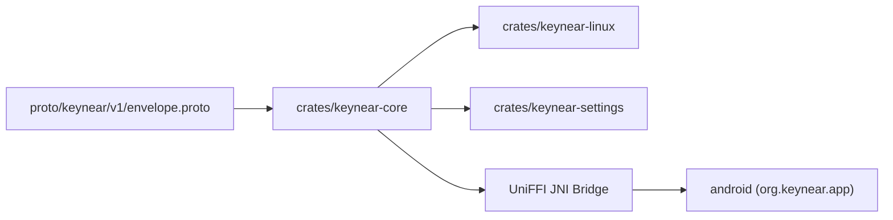

# System Overview

`Keynear` (`0.5.0-draco`) is a single monorepo containing a shared Rust core, Linux desktop binaries, Protocol Buffers schemas, and an Android companion app.

## Module Topology

## Workspace Layout

- The shared Rust core in `crates/keynear-core` defines the domain models (`PairedDevice`, `PairedDeviceStore`, `NearbyPeer`, `DaemonConfig`, `TransferSession`), display-name validation (`MAX_DISPLAY_NAME_LEN`, `validate_display_name`) and atomic config/device TOML persistence (`DaemonConfig::save_to_path`, `PairedDeviceStore::rename`), BLE presence and AES-256-GCM LAN endpoint codecs (`presence.rs`, UUIDs `0xFE6D` and `0xFE70`), `Noise_XX_25519_ChaChaPoly_BLAKE2s` pairing (`pairing.rs`, 120-second timeout, 6-digit verification codes), relay-free `iroh` P2P QUIC transport with `rustls` `X25519MLKEM768` (`quic.rs`), `mdns-sd` local discovery (`lan_discovery.rs`), 60 KiB chunked and `STORED` zip file streaming with `OwnedFd` zero-copy I/O and consent gating (`transfer.rs`), delayed-render clipboard engine and MIME policy filter (`clipboard.rs`), secret storage traits (`keyring.rs`, `oo7_keyring.rs`), bounded `proto3` control framing (`MAX_CONTROL_FRAME_BYTES = 65_536`, `QuicStreamKind::ClipboardBlob`), and UniFFI bindings (`uniffi_bridge.rs`) for Android.
- The Linux daemon in `crates/keynear-linux` runs as an asynchronous `tokio` service under `systemd --user`. It manages BlueZ (`bluer`) BLE advertising and scanning, GATT pairing (`0xFE6E`/`0xFE6F`) and encrypted LAN endpoint exchange (`0xFE70`), `mdns-sd` `_keynear._udp.local.` discovery, the `OrionQuicNode` accept loop with `QuicStreamKind` demultiplexing between `TransferEngine` and `ClipboardEngine`, native Wayland (`ext-data-control-v1`, `zwlr-data-control-v1`) and X11 (`x11rb`) clipboard monitoring with pre-read MIME filtering and echo suppression (`clipboard.rs`), memory-only `latest_otp` retention, the 10-minute `EveryoneNearby` auto-revert (`EVERYONE_NEARBY_TIMEOUT_SECS = 600`), a `ksni` `StatusNotifierItem` tray menu (`tray.rs`) with live `Everyone (MM:SS)` countdown updates, **Copy latest OTP**, and `keynear-settings` launcher, `zbus` `org.freedesktop.Notifications` desktop prompts with `ActionInvoked` handling (`notifications.rs`), and `daemon.sock` (`0o600`) Unix IPC for visibility, device rename, configuration, and transfer CLI commands (`--status`, `--devices`, `--set-visibility`, `--rename-device`, `--send`, `--accept`, `--decline`, `--cancel`, `--transfers`). It degrades gracefully when BlueZ, mDNS, Wayland/X11 clipboard, D-Bus notifications/tray watcher, or Secret Service are unavailable. PipeWire audio handoff and the GNOME Shell Mutter D-Bus clipboard bridge arrive in `1.0.0-vega`.
- The settings binary in `crates/keynear-settings` is a short-lived, on-demand GTK4/`relm4` preferences and send window. It integrates `ashpd` (`xdg-desktop-portal`) file, folder, and incoming-directory selection, visibility mode buttons with a live `Everyone (MM:SS)` countdown, a global `auto_accept_from_paired` toggle, live `Clipboard sync`, `Sync clipboard images`, `2FA code pass-through`, and `Ignored clipboard formats` controls propagated via `UpdateConfig`/`GetConfig` IPC, nearby discovered peers, inline 6-digit Noise XX pairing confirmation, paired devices with inline rename, per-device `Auto-accept files` switches, and two-step unpair cleanup across `devices.toml` and `oo7`, plus an `Active transfers` card (`Accept`, `Decline`, `Cancel`) and `--send-picker` / `--share` entrypoints wired into Nautilus, Dolphin, and Yazi context menus (`integrations/`).
- The wire schema at `proto/keynear/v1/envelope.proto` defines `Envelope` and the payloads `HandshakePayload` (`auth_proof`), `TransferOffer`, `ClipboardPayload`, `AudioStatePayload`, `ControlAck`, `LanEndpoint`, `TransferConsent`, `TransferCancel`, `TransferComplete`, `ClipboardOffer`, and `ClipboardFetch`.
- The Android companion in `android/` is a Kotlin and Jetpack Compose application (`org.keynear.app`, `versionCode = 5`, `versionName = "0.5.0-draco"`). It provides `KeynearBleManager` (advertiser, `PendingIntent` scanner via `BleScanReceiver`, Noise XX GATT client/server, and `0xFE70` LAN endpoint exchange), `LocalNetworkManager` (`NsdManager` `_keynear._udp.` discovery with SDK 37+ reflection guards for `FLAG_SHOW_PICKER` and `onBlockedStatusChanged` LNP checks), `CoreClient` (`OrionNodeHandle`, `MediaStore.Downloads` pending-row + `ParcelFileDescriptor.detachFd()` zero-copy FD handoff, background clipboard receive, clipboard/OTP dispatch, device rename, permission checklist evaluation, and transfer progress modeling), `KeynearCompanionDeviceService`, `PairingNotificationManager` (pairing prompts, incoming consent, API 36 `Notification.ProgressStyle` 3-segment progress and API 31–35 `NotificationCompat` fallbacks, completion, error, and LNP blocked alerts), `KeynearTransferJobService` (`User-Initiated Data Transfer Jobs` on API 34+), `KeystoreSecretStore` (Android Keystore AES-256-GCM), `KeynearForegroundService` (silent `connectedDevice` continuity with **Copy phone clipboard** action and background clipboard/OTP sync), lock-aware `KeynearTileService` (`isLocked`/`unlockAndRun`), `ClipboardTileService` + `ClipboardReadActivity` (focused translucent phone clipboard reader), `SmsUserConsentManager` (Google Play Services SMS User Consent OTP forwarding gated by `otpPassthroughEnabled`), `MainActivity` (collapsible permissions onboarding checklist, LNP banner, `Active transfers`, inline device rename, `Auto-accept files` switches, and SMS consent launcher), `DirectShareManager`, and `ShareActivity` (bottom-sheet Direct Share and target picker for `ACTION_SEND` and `ACTION_SEND_MULTIPLE`).
