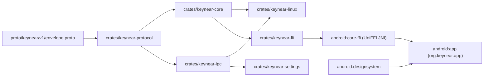

# System Overview

Keynear (`1.2.0-carina`) is a single monorepo with a shared Rust core, Linux desktop binaries, Protocol Buffers schemas, and an Android companion app.

## Module Topology

## Workspace Layout

The workspace is organized into the following crates and modules.

- `crates/keynear-protocol` is the wire and domain contract crate. It defines:
  - `proto3` codegen and the domain models `PairedDevice`, `PairedDeviceStore`, `NearbyPeer`, `DaemonConfig`, and `TransferSession`.
  - Display-name validation (`MAX_DISPLAY_NAME_LEN`, `validate_display_name`).
  - Atomic config and device TOML persistence (`DaemonConfig::save_to_path`, `PairedDeviceStore::rename`).
  - `KeynearError` and constants.
- `crates/keynear-core` is the cross-platform engine, with no UniFFI or `oo7` dependency. It provides:
  - BLE presence and AES-256-GCM LAN endpoint codecs (`transport/presence.rs`, UUIDs `0xFE6D` and `0xFE70`).
  - `Noise_XX_25519_ChaChaPoly_BLAKE2s` pairing (`pairing/`, 120-second timeout, 6-digit verification codes).
  - Relay-free `iroh` P2P QUIC transport with `rustls` `X25519MLKEM768` (`transport/quic.rs`).
  - `mdns-sd` local discovery (`transport/lan_discovery.rs`).
  - 60 KiB chunked and `STORED` zip file streaming with `OwnedFd` zero-copy I/O and consent gating (`transfer/`).
  - A delayed-render clipboard engine and MIME policy filter (`clipboard/`).
  - Named Vega capability bits and pure negotiation (`capability.rs`).
  - The ordered audio handoff state machine (`audio.rs`).
  - Wi-Fi Aware-before-Direct fallback selection (`fallback.rs`).
  - Bounded checkpoint bitmaps and a rolling SHA-256 chain with a pure resume decision (`resume.rs`).
  - A virtual-filesystem model of opaque remote roots, documents, and on-demand read plans (`vfs/`).
  - The platform-agnostic `SecretStore` trait and `InMemorySecretStore` (`keyring.rs`).
- `crates/keynear-ffi` exposes the UniFFI bridge, split across `pairing.rs`, `transfer.rs`, `clipboard.rs`, `vega.rs`, `perseus.rs`, `carina.rs`, `callbacks.rs`, and `bin/uniffi_bindgen.rs`. It builds `libkeynear_core.so` for Android `:core-ffi`.
- `crates/keynear-ipc` defines the shared Linux daemon and UI IPC schema, the frame codec, and the Unix domain socket client used by both `keynear-linux` and `keynear-settings`.
- `crates/keynear-linux` is the Linux daemon, an asynchronous `tokio` service (`service/`) under `packaging/linux/systemd/keynear.service`. It manages:
  - BlueZ (`bluer`) BLE advertising, scanning, and GATT pairing (`ble/`).
  - `mdns-sd` `_keynear._udp.local.` discovery.
  - `Oo7SecretStore` (`keyring_oo7.rs`).
  - Native Wayland (`ext-data-control-v1`, `zwlr-data-control-v1`) and X11 (`x11rb`) clipboard monitoring with pre-read MIME filtering and echo suppression (`clipboard.rs`).
  - Memory-only `latest_otp` retention.
  - The 10-minute `EveryoneNearby` auto-revert (`EVERYONE_NEARBY_TIMEOUT_SECS = 600`).
  - A `ksni` `StatusNotifierItem` tray menu (`tray.rs`).
  - `zbus` notifications (`notifications.rs`).
  - CLI parsing (`cli.rs`).
  - `daemon.sock` (`0o600`) Unix IPC handlers (`ipc/`).

  The daemon degrades gracefully when BlueZ, mDNS, Wayland/X11 clipboard, D-Bus notifications or tray watcher, or Secret Service are unavailable. Three release layers extend it further.

  - Vega adds a `zbus` BlueZ/MPRIS2 sink observer and handoff controller (`audio/`), a graded `wpa_supplicant` no-LAN prober (`fallback.rs`), and startup capability advertisement (`vega.rs`). A headless GNOME Shell D-Bus clipboard bridge lives under `packaging/gnome/keynear-clipboard@hydrafog.github.com/`.
  - Perseus adds a typed FUSE mount controller with an injectable backend and an explicit unavailable result when kernel FUSE or `libfuse3` is absent (`fuse/`, `perseus.rs`). The real `fuser` adapter is optional behind the `fuse` Cargo feature so the default build stays headless.
  - Carina extends the notification client with mirrored reply, mark-as-read, and dismiss actions (`notifications/`), adds an MPRIS2 media observer and a `Now playing` tray group (`media.rs`, `tray/media_menu.rs`), and routes call actions through a typed dispatcher (`call.rs`, `ipc/handlers/actions.rs`).
- `crates/keynear-settings` is a short-lived, on-demand GTK4/`relm4` preferences and send window. It consumes `keynear-ipc` and `keynear-protocol` directly, and its code lives in `state/`, `views/`, `app.rs`, `portal.rs`, `main.rs`, and integration tests in `tests/`. It provides:
  - `ashpd` file and folder choosers.
  - Visibility mode controls and clipboard and OTP settings.
  - Inline pairing confirmation and device rename.
  - Per-device `Auto-accept files` switches.
  - Two-step unpair cleanup over `IpcRequest::UnpairDevice`.
  - `Active transfers`.
  - `--send-picker` and `--share` entrypoints wired into Nautilus, Dolphin, and Yazi context menus (`packaging/linux/integrations/`).
- The wire schema at `proto/keynear/v1/envelope.proto` defines `Envelope` and three groups of payloads.
  - The base payloads are `HandshakePayload` (`auth_proof`), `TransferOffer`, `ClipboardPayload`, `AudioStatePayload`, `ControlAck`, `LanEndpoint`, `TransferConsent`, `TransferCancel`, `TransferComplete`, `ClipboardOffer`, and `ClipboardFetch`.
  - The Vega messages are `AudioHandoff`, `CapabilityNegotiation`, and `FallbackProbe`.
  - The Perseus messages are `TransferCheckpoint`, `TransferResumeRequest`, and `TransferResumeAck` at tags `24..26`.
  - The Carina messages are `MirroredNotification`, `NotificationAction`, `CallAlert`, `CallAction`, `MediaSessionState`, and `MediaCommand` at tags `27..32`.
- The Android companion in `android/` splits into three Gradle modules.
  - `:core-ffi` holds Gradle-generated UniFFI Kotlin bindings and 16 KB ELF page-aligned `jniLibs/`.
  - `:designsystem` holds `Tokens.kt`, `Theme.kt`, `KeynearIcons.kt`, and split `Controls*` components in `org.keynear.designsystem`.
  - `:app` (`org.keynear.app`, `versionCode = 8`, `versionName = "1.2.0-carina"`) separates several concerns:
    - BLE: `BleScanner`, `BleAdvertiser`, `GattSession`, and `PairingNotifier`.
    - Core bridge and event loop: `bridge/{CoreBridge,EventQueue,KeystoreSecretStore}`.
    - Repositories and LAN discovery: `data/{DeviceRepo,TransferRepo,PairingRepo,LanManager}`.
    - Background services: `service/`.
    - Share and Direct Share: `share/{ShareActivity,IntentResolver,DirectShareManager}`.
    - Pure Vega negotiation helpers: `vega/{VegaCapability,RangingPolicy,FallbackSelection}`.
    - A manifest-registered `DocumentsProvider` with pure descriptor and stream helpers: `vfs/{KeynearDocumentsProvider,VfsDescriptors,RemoteDocumentStream}`.
    - Notification mirroring behind an explicit opt-in with pure exclusion helpers: `notifications/{KeynearNotificationListenerService,NotificationMirror}`.
    - Call actions through `TelecomManager` with a screening fallback: `call/{CallAlertController,KeynearCallScreeningService}`.
    - Media session state for the Quick Settings carousel: `media/MediaBridgeController`.
    - Compose screens and UI state: `ui/{devices,navigation,receive,send,settings,model}`.
