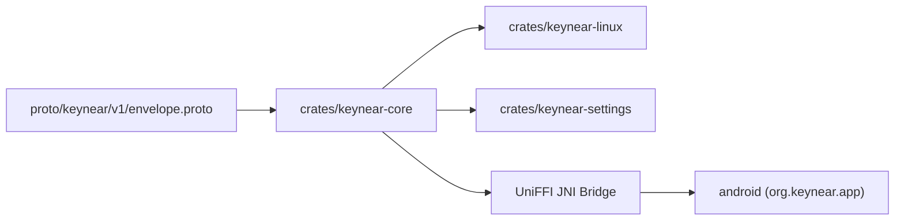

# System Overview

`Keynear` is organized as a single monorepo containing a shared Rust core, Linux desktop binaries, Protocol Buffers schemas, and an Android companion app.

## Module Topology

## Workspace Layout

- **Shared Rust Core (`crates/keynear-core`)**: Domain models (`PairedDevice`, `NearbyPeer`, `TransferSession`, `TransferItem`, `DaemonConfig`), bounded `proto3` control framing (`MAX_CONTROL_FRAME_BYTES = 65_536`), and UniFFI FFI bindings for Android.
- **Linux Daemon (`crates/keynear-linux`)**: Asynchronous `tokio` background daemon running under `systemd --user`, managing BLE discovery, QUIC transport, `StatusNotifierItem` tray integration, Wayland clipboard sync, and PipeWire audio handoff.
- **Linux Settings (`crates/keynear-settings`)**: Short-lived, on-demand GTK4/`relm4` preferences binary launched from the tray menu to manage paired devices, incoming directories, and feature toggles.
- **Wire Schema (`proto/keynear/v1/envelope.proto`)**: Protocol Buffers schema defining `Envelope` and continuity payloads (`HandshakePayload`, `TransferOffer`, `ClipboardPayload`, `AudioStatePayload`, `ControlAck`).
- **Android Companion (`android/`)**: Kotlin and Jetpack Compose application (`org.keynear.app`) providing `KeynearForegroundService` (`connectedDevice`), `KeynearTileService`, `ShareActivity`, and one-time permission onboarding.
