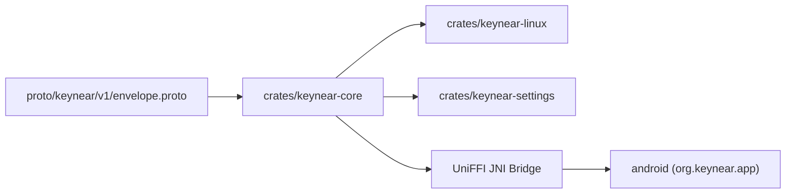

# System Overview

`Keynear` (`0.3.0-orion`) is a single monorepo containing a shared Rust core, Linux desktop binaries, Protocol Buffers schemas, and an Android companion app.

## Module Topology

## Workspace Layout

- The shared Rust core in `crates/keynear-core` defines the domain models (`PairedDevice`, `PairedDeviceStore`, `NearbyPeer`, `DaemonConfig`, `TransferSession`), BLE presence and AES-256-GCM LAN endpoint codecs (`presence.rs`, UUIDs `0xFE6D` and `0xFE70`), `Noise_XX_25519_ChaChaPoly_BLAKE2s` pairing (`pairing.rs`, 120-second timeout, 6-digit verification codes), relay-free `iroh` P2P QUIC transport with `rustls` `X25519MLKEM768` (`quic.rs`), `mdns-sd` local discovery (`lan_discovery.rs`), 60 KiB chunked and `STORED` zip file streaming with `OwnedFd` zero-copy I/O and consent gating (`transfer.rs`), secret storage traits (`keyring.rs`, `oo7_keyring.rs`), bounded `proto3` control framing (`MAX_CONTROL_FRAME_BYTES = 65_536`), and UniFFI bindings (`uniffi_bridge.rs`) for Android.
- The Linux daemon in `crates/keynear-linux` runs as an asynchronous `tokio` service under `systemd --user`. It manages BlueZ (`bluer`) BLE advertising and scanning, GATT pairing (`0xFE6E`/`0xFE6F`) and encrypted LAN endpoint exchange (`0xFE70`), `mdns-sd` `_keynear._udp.local.` discovery, the `OrionQuicNode` accept loop and `TransferEngine`, the 10-minute `EveryoneNearby` auto-revert (`EVERYONE_NEARBY_TIMEOUT_SECS = 600`), and `daemon.sock` (`0o600`) Unix IPC for CLI transfer commands (`--send`, `--accept`, `--decline`, `--cancel`, `--transfers`). It degrades gracefully when BlueZ, mDNS, or D-Bus Secret Service are unavailable. `ksni` tray integration and `ashpd` portals arrive in `0.4.0-aquila`, Wayland clipboard sync arrives in `0.5.0-draco`, and PipeWire audio handoff arrives in `1.0.0-vega`.
- The settings binary in `crates/keynear-settings` is a short-lived, on-demand GTK4/`relm4` preferences window. It shows visibility controls with a live `Everyone (MM:SS)` countdown, nearby discovered peers, inline 6-digit Noise XX pairing confirmation, paired devices with per-device `Auto-accept files` switches and two-step unpair cleanup across `devices.toml` and `oo7`, and an `Active transfers` card (`Accept`, `Decline`, `Cancel`) backed by `daemon.sock` IPC.
- The wire schema at `proto/keynear/v1/envelope.proto` defines `Envelope` and the payloads `HandshakePayload` (`auth_proof`), `TransferOffer`, `ClipboardPayload`, `AudioStatePayload`, `ControlAck`, `LanEndpoint`, `TransferConsent`, `TransferCancel`, and `TransferComplete`.
- The Android companion in `android/` is a Kotlin and Jetpack Compose application (`org.keynear.app`, `versionCode = 3`, `versionName = "0.3.0-orion"`). It provides `KeynearBleManager` (advertiser, `PendingIntent` scanner via `BleScanReceiver`, Noise XX GATT client/server, and `0xFE70` LAN endpoint exchange), `LocalNetworkManager` (`NsdManager` `_keynear._udp.` discovery with SDK 37+ reflection guards for `FLAG_SHOW_PICKER` and `onBlockedStatusChanged` LNP checks), `CoreClient` (`OrionNodeHandle`, `MediaStore.Downloads` pending-row + `ParcelFileDescriptor.detachFd()` zero-copy FD handoff, and transfer consent actions), `KeynearCompanionDeviceService`, `PairingNotificationManager` (pairing, incoming drop consent, completion, error, and LNP blocked alerts), `KeystoreSecretStore` (Android Keystore AES-256-GCM), `KeynearForegroundService`, `KeynearTileService`, `MainActivity` (LNP banner, `Active transfers`, `Auto-accept files` switches), and `ShareActivity` (paired-target selector for `ACTION_SEND` and `ACTION_SEND_MULTIPLE`).
