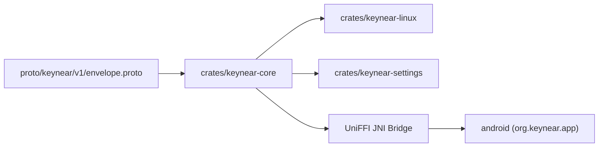

# System Overview

`Keynear` (`0.2.0-cygnus`) is a single monorepo containing a shared Rust core, Linux desktop binaries, Protocol Buffers schemas, and an Android companion app.

## Module Topology

## Workspace Layout

- The shared Rust core in `crates/keynear-core` defines the domain models (`PairedDevice`, `PairedDeviceStore`, `NearbyPeer`, `DaemonConfig`), Cygnus BLE presence and beacon encoding (`presence.rs`, UUID `0xFE6D`), the `Noise_XX_25519_ChaChaPoly_BLAKE2s` pairing state machine (`pairing.rs`, 120-second timeout, 6-digit verification codes), secret storage traits (`keyring.rs`, `oo7_keyring.rs`), bounded `proto3` control framing (`MAX_CONTROL_FRAME_BYTES = 65_536`), and UniFFI bindings (`uniffi_bridge.rs`) for Android.
- The Linux daemon in `crates/keynear-linux` runs as an asynchronous `tokio` background service under `systemd --user`. It manages BlueZ (`bluer`) BLE advertising, scanning, the GATT pairing responder on `0xFE6E` and `0xFE6F`, the 10-minute `EveryoneNearby` auto-revert (`EVERYONE_NEARBY_TIMEOUT_SECS = 600`), and `StatusNotifierItem` tray integration, and it degrades gracefully when BlueZ or the D-Bus Secret Service is unavailable. QUIC transport, Wayland clipboard sync, and PipeWire audio handoff arrive in later milestones (`0.3.0-orion` and after).
- The settings binary in `crates/keynear-settings` is a short-lived, on-demand GTK4/`relm4` preferences window. It shows visibility controls with a live `Everyone (MM:SS)` countdown, nearby discovered peers, inline 6-digit Noise XX pairing confirmation, paired devices, and two-step unpair cleanup across `devices.toml` and `oo7`.
- The wire schema at `proto/keynear/v1/envelope.proto` defines `Envelope` and the continuity payloads `HandshakePayload`, `TransferOffer`, `ClipboardPayload`, `AudioStatePayload`, and `ControlAck`.
- The Android companion in `android/` is a Kotlin and Jetpack Compose application (`org.keynear.app`). It provides `KeynearBleManager` with an advertiser and a `PendingIntent` scanner through `BleScanReceiver` that drives `FfiNoisePairingSession` over GATT client and server, `KeynearCompanionDeviceService`, `PairingNotificationManager`, `KeystoreSecretStore` backed by Android Keystore AES-256-GCM, `KeynearForegroundService` (`connectedDevice`), `KeynearTileService`, `MainActivity`, and `ShareActivity`.
