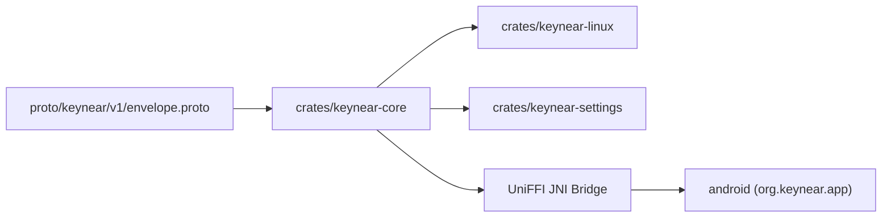

# System Overview

`Keynear` (`0.2.0-cygnus`) is organized as a single monorepo containing a shared Rust core, Linux desktop binaries, Protocol Buffers schemas, and an Android companion app.

## Module Topology

## Workspace Layout

- **Shared Rust Core (`crates/keynear-core`)**: Domain models (`PairedDevice`, `PairedDeviceStore`, `NearbyPeer`, `DaemonConfig`), Cygnus BLE presence/beacon encoding (`presence.rs`, UUID `0xFE6D`), `Noise_XX_25519_ChaChaPoly_BLAKE2s` pairing state machine (`pairing.rs`, 120s timeout, 6-digit verification codes), secret storage traits (`keyring.rs`, `oo7_keyring.rs`), bounded `proto3` control framing (`MAX_CONTROL_FRAME_BYTES = 65_536`), and UniFFI FFI bindings (`uniffi_bridge.rs`) for Android.
- **Linux Daemon (`crates/keynear-linux`)**: Asynchronous `tokio` background daemon running under `systemd --user`, managing BlueZ (`bluer`) BLE advertising, scanning, GATT pairing responder (`0xFE6E`/`0xFE6F`), 10-minute `EveryoneNearby` auto-revert (`EVERYONE_NEARBY_TIMEOUT_SECS = 600`), and `StatusNotifierItem` tray integration, with graceful degradation when BlueZ or D-Bus Secret Service is unavailable. QUIC transport, Wayland clipboard sync, and PipeWire audio handoff activate in subsequent milestones (`0.3.0-orion`+).
- **Linux Settings (`crates/keynear-settings`)**: Short-lived, on-demand GTK4/`relm4` preferences window displaying visibility controls (`Everyone (MM:SS)` live countdown), nearby discovered peers, inline 6-digit Noise XX pairing confirmation, paired devices, and two-step unpair cleanup across `devices.toml` and `oo7`.
- **Wire Schema (`proto/keynear/v1/envelope.proto`)**: Protocol Buffers schema defining `Envelope` and continuity payloads (`HandshakePayload`, `TransferOffer`, `ClipboardPayload`, `AudioStatePayload`, `ControlAck`).
- **Android Companion (`android/`)**: Kotlin and Jetpack Compose application (`org.keynear.app`) providing `KeynearBleManager` (advertiser, `PendingIntent` scanner via `BleScanReceiver`, GATT client/server driving `FfiNoisePairingSession`), `KeynearCompanionDeviceService`, `PairingNotificationManager`, `KeystoreSecretStore` (Android Keystore AES-256-GCM), `KeynearForegroundService` (`connectedDevice`), `KeynearTileService`, `MainActivity`, and `ShareActivity`.
