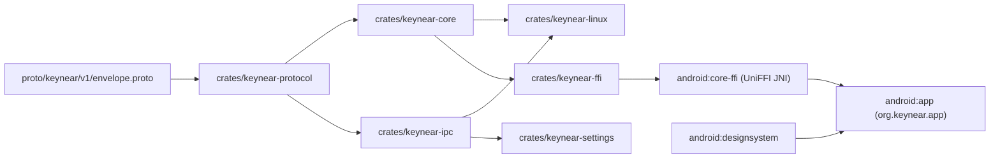

# System Overview

`Keynear` (`1.0.0-vega`) is a single monorepo containing a shared Rust core, Linux desktop binaries, Protocol Buffers schemas, and an Android companion app.

## Module Topology

## Workspace Layout

- The wire and domain contract crate in `crates/keynear-protocol` defines `proto3` codegen, domain models (`PairedDevice`, `PairedDeviceStore`, `NearbyPeer`, `DaemonConfig`, `TransferSession`), display-name validation (`MAX_DISPLAY_NAME_LEN`, `validate_display_name`), atomic config/device TOML persistence (`DaemonConfig::save_to_path`, `PairedDeviceStore::rename`), `KeynearError`, and constants.
- The cross-platform engine crate in `crates/keynear-core` (free of UniFFI and `oo7`) provides BLE presence and AES-256-GCM LAN endpoint codecs (`transport/presence.rs`, UUIDs `0xFE6D` and `0xFE70`), `Noise_XX_25519_ChaChaPoly_BLAKE2s` pairing (`pairing/`, 120-second timeout, 6-digit verification codes), relay-free `iroh` P2P QUIC transport with `rustls` `X25519MLKEM768` (`transport/quic.rs`), `mdns-sd` local discovery (`transport/lan_discovery.rs`), 60 KiB chunked and `STORED` zip file streaming with `OwnedFd` zero-copy I/O and consent gating (`transfer/`), delayed-render clipboard engine and MIME policy filter (`clipboard/`), named Vega capability bits and pure negotiation (`capability.rs`), the ordered audio handoff state machine (`audio.rs`), Wi-Fi Aware-before-Direct fallback selection (`fallback.rs`), and the platform-agnostic `SecretStore` trait + `InMemorySecretStore` (`keyring.rs`).
- `crates/keynear-ffi` exposes the UniFFI bridge (split across `pairing.rs`, `transfer.rs`, `clipboard.rs`, `vega.rs`, `callbacks.rs`, and `bin/uniffi_bindgen.rs`) and builds `libkeynear_core.so` for Android `:core-ffi`.
- `crates/keynear-ipc` defines the shared Linux daemon/UI IPC schema, frame codec, and Unix domain socket client consumed by both `keynear-linux` and `keynear-settings`.
- The Linux daemon in `crates/keynear-linux` runs as an asynchronous `tokio` service (`service/`) under `packaging/linux/systemd/keynear.service`. It manages BlueZ (`bluer`) BLE advertising, scanning, and GATT pairing (`ble/`), `mdns-sd` `_keynear._udp.local.` discovery, `Oo7SecretStore` (`keyring_oo7.rs`), native Wayland (`ext-data-control-v1`, `zwlr-data-control-v1`) and X11 (`x11rb`) clipboard monitoring with pre-read MIME filtering and echo suppression (`clipboard.rs`), memory-only `latest_otp` retention, the 10-minute `EveryoneNearby` auto-revert (`EVERYONE_NEARBY_TIMEOUT_SECS = 600`), a `ksni` `StatusNotifierItem` tray menu (`tray.rs`), `zbus` notifications (`notifications.rs`), CLI parsing (`cli.rs`), and `daemon.sock` (`0o600`) Unix IPC handlers (`ipc/`). It degrades gracefully when BlueZ, mDNS, Wayland/X11 clipboard, D-Bus notifications/tray watcher, or Secret Service are unavailable. Vega adds a `zbus` BlueZ/MPRIS2 sink observer and handoff controller (`audio/`), a graded `wpa_supplicant` no-LAN prober (`fallback.rs`), and startup capability advertisement (`vega.rs`), with a headless GNOME Shell D-Bus clipboard bridge under `packaging/gnome/keynear-clipboard@hydrafog.github.com/`.
- The settings binary in `crates/keynear-settings` (`state/`, `views/`, `app.rs`, `portal.rs`, `main.rs`, and integration tests in `tests/`) is a short-lived, on-demand GTK4/`relm4` preferences and send window consuming `keynear-ipc` and `keynear-protocol` directly. It integrates `ashpd` file/folder choosers, visibility mode controls, clipboard/OTP settings, inline pairing confirmation, device rename, per-device `Auto-accept files` switches, two-step unpair cleanup over `IpcRequest::UnpairDevice`, `Active transfers`, and `--send-picker` / `--share` entrypoints wired into Nautilus, Dolphin, and Yazi context menus (`packaging/linux/integrations/`).
- The wire schema at `proto/keynear/v1/envelope.proto` defines `Envelope` and the payloads `HandshakePayload` (`auth_proof`), `TransferOffer`, `ClipboardPayload`, `AudioStatePayload`, `ControlAck`, `LanEndpoint`, `TransferConsent`, `TransferCancel`, `TransferComplete`, `ClipboardOffer`, `ClipboardFetch`, and the Vega messages `AudioHandoff`, `CapabilityNegotiation`, and `FallbackProbe`.
- The Android companion in `android/` is split into three Gradle modules: `:core-ffi` (Gradle-generated UniFFI Kotlin bindings and 16 KB ELF page-aligned `jniLibs/`), `:designsystem` (`Tokens.kt`, `Theme.kt`, `KeynearIcons.kt`, and split `Controls*` components in `org.keynear.designsystem`), and `:app` (`org.keynear.app`, `versionCode = 6`, `versionName = "1.0.0-vega"`). `:app` separates BLE (`BleScanner`, `BleAdvertiser`, `GattSession`, `PairingNotifier`), core bridge/event loop (`bridge/{CoreBridge,EventQueue,KeystoreSecretStore}`), repositories and LAN discovery (`data/{DeviceRepo,TransferRepo,PairingRepo,LanManager}`), background services (`service/`), Share/Direct Share (`share/{ShareActivity,IntentResolver,DirectShareManager}`), pure Vega negotiation helpers (`vega/{VegaCapability,RangingPolicy,FallbackSelection}`), and Compose screens + UI state (`ui/{devices,navigation,receive,send,settings,model}`).
