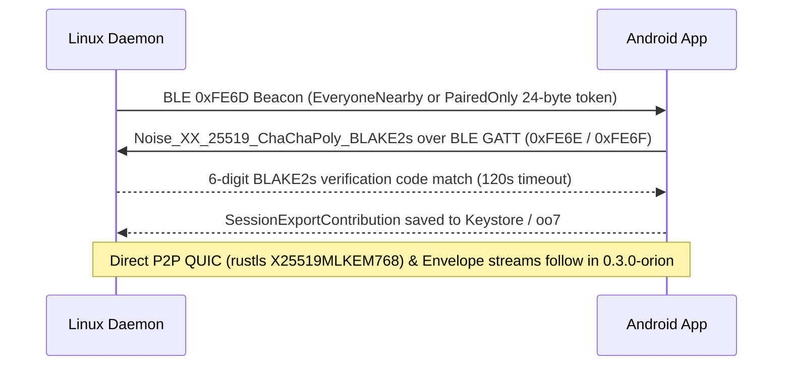

# Protocol and Cryptography

`Keynear` discovery, pairing, and continuity transport run peer-to-peer without cloud accounts or relay servers.

## Pairing and Transport Flow

## Proximity Discovery and Pairing (`0.2.0-cygnus`)

- Keynear advertises and filters on the 16-bit BLE Service UUID `0xFE6D` (`0000FE6D-0000-1000-8000-00805F9B34FB`). The GATT Pairing TX characteristic `0xFE6E` supports `Write` and `WriteWithoutResponse`, and the Pairing RX characteristic `0xFE6F` supports `Notify` up to `MAX_GATT_PAIRING_FRAME_BYTES = 512`.
- Beacons stay within `MAX_BEACON_DATA_BYTES = 24`. Everyone nearby carries the protocol version, device role, visibility flag, truncated UTF-8 display name, and capability bitmask for open pairing discovery, and reverts to paired devices only after `600` seconds. Paired devices only carries a 6-byte rotating HMAC-SHA256 presence token (`device_id || u32 counter` keyed by the pairwise `irk`), a 4-byte little-endian `u32` counter, and a 14-byte AES-256-GCM encrypted state payload (`availability`, optional `battery_level`, authenticated with `reconnect_secret` and a deterministic 96-bit nonce).
- Initial pairing executes `Noise_XX_25519_ChaChaPoly_BLAKE2s` (`snow`) over BLE GATT. After the handshake both sides derive a 6-digit verification code (`000000`–`999999`) from `BLAKE2s(handshake_hash || "keynear-verify-v1")` and require user confirmation within `120` seconds before committing `SessionExportContribution` (`device_id`, `display_name`, `role`, `capability_flags`, `irk`, `reconnect_secret`) to `PairedDeviceStore` and OS secret storage.

## Bounded Framing, FFI Boundary, and Planned QUIC Link

- `crates/keynear-core/build.rs` compiles `proto/keynear/v1/envelope.proto` with `prost-build` into `keynear_core::proto::v1`.
- `ControlFrame` (`encode_control_frame`, `decode_control_frame`, `envelope_to_control_frame`, `control_frame_to_envelope`) validates `MAX_CONTROL_FRAME_BYTES` (`65_536` bytes) before decoding and rejects empty `Envelope` payloads and unknown frame kinds.
- `crates/keynear-core/src/uniffi_bridge.rs` exports `CoreHandle`, `FfiNoisePairingSession`, `CoreStatus`, `FfiVisibilityMode`, the beacon codecs, store and countdown helpers, and `FfiError` over `libkeynear_core.so` (`cdylib`) to `org.keynear.app` on Android.
- The planned Wi-Fi QUIC data links use `rustls` with hybrid `X25519MLKEM768` (RFC 10024) key exchange, targeted for `0.3.0-orion`.
