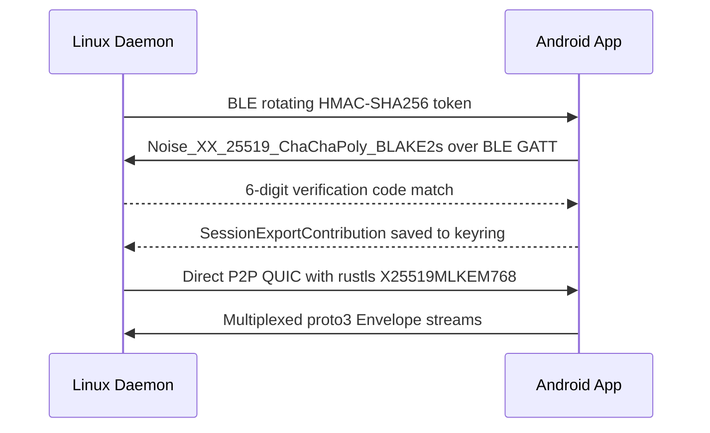

# Protocol and Cryptography

All `Keynear` discovery, pairing, and data transport operate peer-to-peer without cloud accounts or relay servers.

## Pairing and Transport Flow

## Proximity Discovery and Pairing

- **Presence Tokens**: Paired devices derive rotating 6-byte HMAC-SHA256 presence tokens from `DeviceId + Counter` and the pairwise `ReconnectKey`, preventing passive MAC or identity tracking.
- **BLE Payload**: An AES-GCM encrypted state payload carries availability and battery status within the 31-byte BLE service-data limit.
- **Pairing Handshake**: Initial pairing executes `Noise_XX_25519_ChaChaPoly_BLAKE2s` over BLE GATT, deriving a 6-digit verification code from the handshake transcript hash and exchanging a `SessionExportContribution` for subsequent silent reconnects.

## Encrypted QUIC Transport

- **Wire Format**: Control and continuity messages serialize as `proto3` `Envelope` frames (`sequence`, `timestamp_ms`, and bounded `65_536`-byte control frames) over multiplexed QUIC streams (`iroh` with public relays and DNS/pkarr disabled).
- **Post-Quantum TLS 1.3**: Wi-Fi QUIC links use `rustls` with hybrid `X25519MLKEM768` (RFC 10024) key exchange, selecting AES-256-GCM when hardware-accelerated on both peers and ChaCha20-Poly1305 otherwise.
