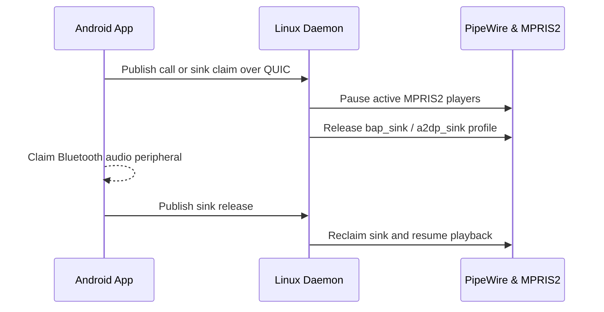

# Smart Audio Handoff

`Keynear` coordinates shared Bluetooth audio peripherals (earbuds, headphones, and speakers) between Linux and Android without a mid-stream disconnect.

## Handoff Sequence

## Coordination Details

- `keynear-linux` monitors BlueZ device and transport objects alongside PipeWire (`bap_sink` for LE Audio, `a2dp_sink`, and `hfp_hf`) and MPRIS2 media players.
- Android publishes call and sink state over the continuity channel. Linux pauses active MPRIS2 playback and releases the PipeWire sink profile before the peer claims the headset, then reclaims the sink and resumes playback when it returns.
