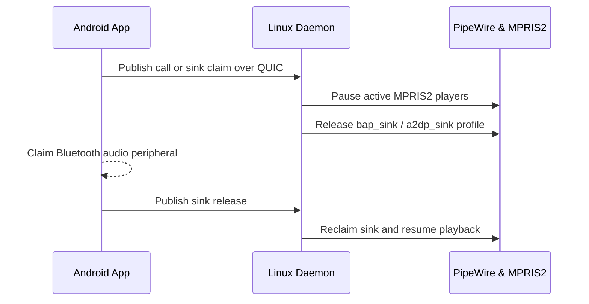

# Smart Audio Handoff

`Keynear` (`1.1.0-perseus`) coordinates shared Bluetooth audio peripherals (earbuds, headphones, and speakers) between Linux and Android without a mid-stream disconnect. The Linux daemon observes BlueZ transports and MPRIS2 players over D-Bus, models `bap_sink`, `a2dp_sink`, and `hfp_hf` as typed sink profiles, and drives an ordered handoff state machine before the peer claims the headset.

## Handoff Sequence

## Coordination Details

- `crates/keynear-core/src/audio.rs` owns `AudioHandoffEngine`, which only advances when `sequence` increases, rejects empty, oversized, or control-character peripheral identifiers before state changes, and records `paused` before `released`. An explicit abort reapplies reclaim and resume effects when a peer claim is rejected, times out, or the daemon shuts down.
- `crates/keynear-linux/src/audio/` calls `org.mpris.MediaPlayer2.Player.Pause` and `Play` and inspects BlueZ `org.bluez.Transport1` profiles through `zbus`. No native PipeWire binding is required. Each backend returns a typed unavailable result and logs `vega_audio_unavailable` when the session or system bus is absent, matching the daemon's other graceful-degrade paths.
- `AudioHandoff` control frames carry the peripheral identifier, monotonically increasing sequence, phase, sink profile, and playback state at tag `21` of `keynear.v1.Envelope`. Retransmitted or out-of-order frames are ignored without advancing the state machine.

## Connectivity Fallbacks and Ranging

- Named capability bits let peers negotiate which Vega features both support. Android advertises audio handoff, Wi-Fi Aware NAN, and Wi-Fi Direct R2; the `RangingManager` capability is checked against hardware and SDK gates before a closeness action is enabled.
- With no shared LAN, `crates/keynear-core/src/fallback.rs` prefers Wi-Fi Aware NAN (`AwarePairingConfig`) over Wi-Fi Direct R2 (`WifiP2pPairingBootstrappingConfig`). The Linux prober reads `fi.w1.wpa_supplicant1` over `zbus` where present and returns an explicit unavailable result otherwise; Aware is host-driven on Android and is never assumed available.
- `FallbackProbe` control frames report the selected medium and its status at tag `23`, and `CapabilityNegotiation` frames report local, peer, and negotiated flags plus the preferred ranging method at tag `22`.

## GNOME Shell Bridge

- The optional GNOME Shell extension under `packaging/gnome/keynear-clipboard@hydrafog.github.com/` owns the `org.keynear.ClipboardBridge` D-Bus name under Mutter and exposes `Sync` and `Status` methods for background clipboard sync. It adds no panel indicator or settings surface and releases the name on disable.
