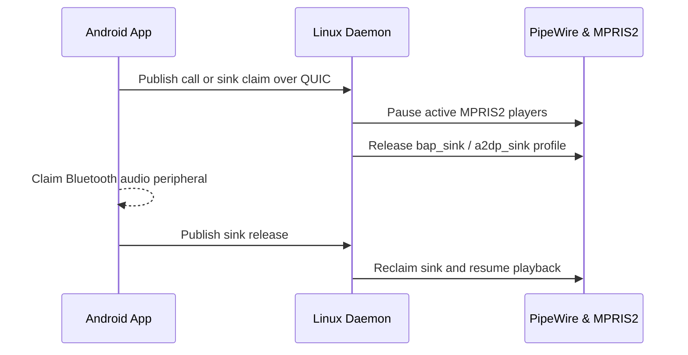

# Smart Audio Handoff

`Keynear` coordinates shared Bluetooth audio peripherals (earbuds, headphones, and speakers) across Linux and Android without mid-stream disconnects.

## Handoff Sequence

## Coordination Details

- **Linux Monitoring**: `keynear-linux` monitors BlueZ device/transport objects alongside PipeWire (`bap_sink` for LE Audio and `a2dp_sink` / `hfp_hf`) and MPRIS2 media players.
- **Conflict-Free Switching**: Android publishes call and sink state over the continuity channel while Linux pauses active MPRIS2 playback and releases the PipeWire sink profile cleanly before the peer claims the headset, resuming playback when the sink returns.
