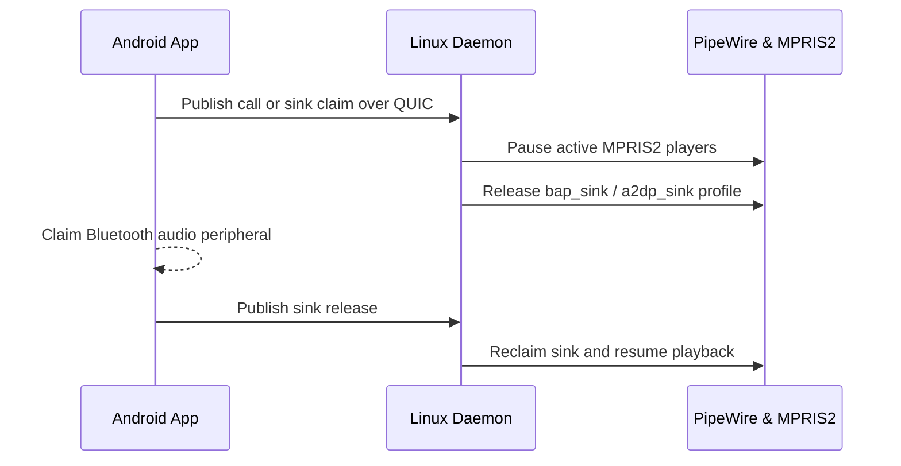

# Smart Audio Handoff

Keynear (`1.3.0-phoenix`) coordinates shared Bluetooth audio peripherals (earbuds, headphones, and speakers) between Linux and Android without a mid-stream disconnect. The Linux daemon observes BlueZ transports and MPRIS2 players over D-Bus. Incoming call alerts reuse the same handoff engine: an incoming call releases the matching `hfp_hf` or `bap_sink` profile, and a decline or end reclaims it. It models `bap_sink`, `bap_source`, `a2dp_sink`, and `hfp_hf` as typed sink profiles and drives an ordered handoff state machine before the peer claims the headset. Phoenix extends this one-shot flow with automatic bidirectional continuity and coordinated LE Audio volume.

## Handoff Sequence

## Automatic Continuity

Phoenix follows whichever paired device starts playback or voice.

- `crates/keynear-core/src/continuity.rs` owns `PhoenixContinuityEngine`. It rejects stale observations, breaks same-sequence ties by stable device id, and emits an ordered release, claim, and resume sequence. A failed claim produces an abort-and-reclaim command that returns the headset to the previous owner instead of stalling playback.
- `AudioContinuityObservation` and `AudioContinuityCommand` control frames carry device id, peripheral id, volume percentage, sink profile, and sequence at tags `33` and `34`. `crates/keynear/src/service/audio_control.rs` dispatches each command to MPRIS2 playback and BlueZ profile switches.
- The Linux backend observes PipeWire sink nodes through the `pipewire` crate and reads and writes `org.bluez.MediaTransport1.Volume` for VCP volume handoff. The `flake.nix` dev shell supplies `llvmPackages.libclang` and glibc includes so the native bindings build reproducibly.
- Capability bits `0x1000` (audio continuity), `0x2000` (proximity lock), and `0x4000` (presence gating) let peers negotiate Phoenix support without changing earlier bits.

## Coordination Details

The handoff engine and OS backends coordinate the handoff.

- The module `crates/keynear-core/src/audio.rs` owns `AudioHandoffEngine`. The engine only advances when `sequence` increases. It rejects empty, oversized, or control-character peripheral identifiers before changing state, and records `paused` before `released`. An explicit abort reapplies reclaim and resume effects when a peer claim is rejected, times out, or the daemon shuts down.
- The daemon drives `VegaAudioController` from a bounded `AudioHandoff` queue in `crates/keynear/src/service/audio_control.rs`. Incoming frames enqueue begin, release, peer-claim, finish, and abort events, and the controller applies pause, release, claim, and resume effects in order. A failed dispatch logs `vega_handoff_dispatch_failed` and leaves the daemon running.
- The module `crates/keynear/src/audio/` calls `org.mpris.MediaPlayer2.Player.Pause` and `Play`. It finds the matching BlueZ `org.bluez.Transport1` object through `zbus` and calls `org.bluez.MediaTransport1.Release` and `Acquire` to switch the `bap_sink`, `a2dp_sink`, or `hfp_hf` profile. No native PipeWire binding is required. When the bus or transport is absent, the release and claim paths log `vega_sink_release_unavailable` or `vega_sink_claim_unavailable` and keep the daemon running. Each backend returns a typed unavailable result and logs `vega_audio_unavailable` when the session or system bus is absent, matching the daemon's other graceful-degrade paths.
- `AudioHandoff` control frames carry the peripheral identifier, monotonically increasing sequence, phase, sink profile, and playback state at tag `21` of `keynear.v1.Envelope`. Keynear ignores retransmitted or out-of-order frames without advancing the state machine.

## Connectivity Fallbacks and Ranging

Keynear negotiates connectivity fallbacks and ranging with capability bits.

- Named capability bits let peers negotiate which Vega features both support. Android advertises audio handoff, Wi-Fi Aware NAN, and Wi-Fi Direct R2. Keynear checks the `RangingManager` capability against hardware and SDK gates before enabling a closeness action.
- With no shared LAN, the module `crates/keynear-core/src/fallback.rs` prefers Wi-Fi Aware NAN (`AwarePairingConfig`) over Wi-Fi Direct R2 (`WifiP2pPairingBootstrappingConfig`). The Linux prober reads `fi.w1.wpa_supplicant1` over `zbus` where present and returns an explicit unavailable result otherwise. Aware is host-driven on Android and is never assumed available.
- `FallbackProbe` control frames report the selected medium and its status at tag `23`. `CapabilityNegotiation` frames report local, peer, and negotiated flags plus the preferred ranging method at tag `22`.

## GNOME Shell Bridge

The optional GNOME Shell extension under `packaging/gnome/keynear-clipboard@hydrafog.github.com/` owns the `org.keynear.ClipboardBridge` D-Bus name under Mutter. It exposes `Sync` and `Status` methods for background clipboard sync, adds no panel indicator or settings surface, and releases the name on disable.
