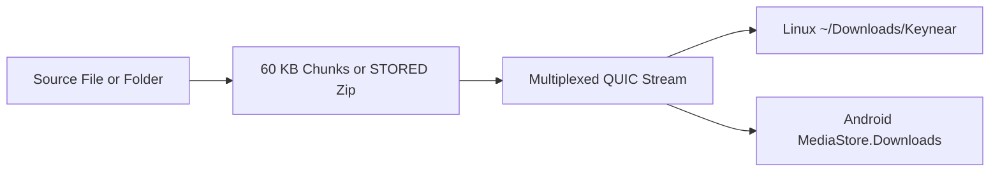

# File Sharing

`Keynear` streams files and directories directly between peers over multiplexed QUIC streams.

## Transfer Pipeline

## Streaming Mechanics

- Files stream in 60 KB chunks directly from disk to QUIC and back. On Android, `ParcelFileDescriptor.detachFd()` passes raw file descriptors into `keynear-core`, which writes into `MediaStore.Downloads` without a JVM heap copy.
- Folders stream as uncompressed `STORED` zip archives with 1 MB buffered I/O and unpack into the incoming directory, which defaults to `~/Downloads/Keynear` on Linux.

## Native OS Entrypoints

- On Linux, the tray Send files… action uses `xdg-desktop-portal` file selection, and file manager context menus cover Nautilus, Dolphin, and Yazi.
- On Android, any app shares through `ACTION_SEND`, `ACTION_SEND_MULTIPLE`, or Direct Share targets in `ShareActivity`, and live transfer progress renders through `Notification.ProgressStyle`.
