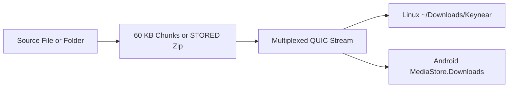

# File Sharing

`Keynear` streams files and directories directly between peers over multiplexed QUIC streams.

## Transfer Pipeline

## Streaming Mechanics

- **Chunked File Transfer**: Files stream in 60 KB chunks directly from disk to QUIC and back. On Android, `ParcelFileDescriptor.detachFd()` passes raw file descriptors into `keynear-core` to write into `MediaStore.Downloads` without JVM heap copies.
- **Directory Archives**: Folders stream as uncompressed `STORED` zip archives with 1 MB buffered I/O and unpack into the target incoming directory (`~/Downloads/Keynear` by default on Linux).

## Native OS Entrypoints

- **Linux**: Send files from the tray **Send files…** action (`xdg-desktop-portal`) or file manager context menus (Nautilus, Dolphin, Yazi).
- **Android**: Share from any app via `ACTION_SEND`, `ACTION_SEND_MULTIPLE`, or Direct Share targets in `ShareActivity`, with live transfer progress rendered through `Notification.ProgressStyle`.
