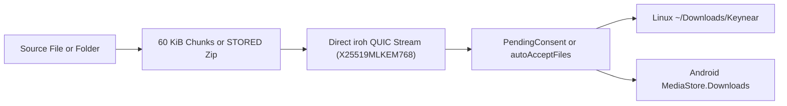

# File Sharing

`Keynear` (`1.1.0-perseus`) streams files and directories directly between paired peers over relay-free `iroh` QUIC streams.

## Transfer Pipeline

## Streaming Mechanics

- Individual files stream in 60 KiB (`61_440`-byte, `STREAM_CHUNK_BYTES`) chunks over `QuicStreamKind::RawFileChunk`. On Android, `CoreClient` inserts a `MediaStore.Downloads` row with `IS_PENDING = 1`, passes `ParcelFileDescriptor.detachFd()` (`OwnedFd` in Rust) to `OrionNodeHandle.provide_receive_fd` or `send_fd` without a JVM heap copy, and clears `IS_PENDING = 0` on completion or deletes the pending row on error or cancellation.
- Directories and multi-file batches stream as uncompressed `CompressionMethod::Stored` zip archives (`zip::ZipWriter::new_stream`) over `QuicStreamKind::StoredZipArchive` using `1 MiB` (`1_048_576`-byte, `ZIP_IO_BUFFER_BYTES`) buffered I/O. Senders skip symlinks (`symlink_metadata`). Receivers spool and validate SHA-256 against `TransferComplete` before unpacking via `ZipArchive` into `incoming_directory` (default `~/Downloads/Keynear` on Linux), rejecting path traversal (`enclosed_name()`), symlinks, encrypted entries, non-`Stored` entries, and byte counts exceeding `TransferOffer.total_bytes`.

## Resumable Transfers and On-Demand Browsing

- `crates/keynear-core/src/resume.rs` records verified 60 KiB chunks in a bit-packed `ChunkBitmap` bounded at `16_384` bytes and extends a rolling SHA-256 chain once per chunk. `TransferCheckpoint` carries the bitmap, the rolling digest, a monotonic `sequence`, and a byte count the receiver validates against the bitmap before skipping any bytes. `resume_from_checkpoint` returns the first unverified chunk only when both peers advertise `CAP_RESUMABLE_TRANSFER` (`0x100`) and the checkpoint is newer than the last accepted one; a peer without the capability starts from chunk zero. `TransferComplete.sha256_digest` still verifies the whole transfer in constant time.
- `crates/keynear-core/src/vfs/` models paired remote roots and opaque document identifiers and builds an on-demand `ReadPlan` that clamps offsets to the file size and caps each request at `STREAM_CHUNK_BYTES`. `crates/keynear-linux/src/fuse/` drives that model through an injectable `FuseMountBackend`; when kernel FUSE or `libfuse3` is absent, the backend logs `perseus_fuse_unavailable` and the daemon continues. The real `fuser` adapter is optional behind the `fuse` Cargo feature.
- On Android, `KeynearDocumentsProvider` is registered as a Storage Access Framework document provider and exposes paired Linux shared directories in the system `Files` app and document pickers. `openDocument` returns a `ParcelFileDescriptor` whose write end is fed by `provide_vfs_read_fd`, and a missing peer yields an empty root set rather than an error.

## Transfer Consent and Auto-Accept

- Incoming `TransferOffer` messages from authenticated paired devices enter `PendingConsent` by default and do not write target files until approved (`TransferConsent(accepted = true)`), transitioning through `Active` to `Completed`, `Cancelled`, or `Failed`.
- Per-device `PairedDevice.auto_accept_files` overrides and global `DaemonConfig.auto_accept_from_paired` (both `false` by default) bypass the consent prompt and transition paired offers straight to `Active`. Declining an offer returns `TransferConsent(accepted = false)` without touching target storage.

## Desktop and Mobile Entrypoints

- **Linux daemon, tray, and notifications**: `keynear-linux` executes `--send <device_id> <path>...`, `--accept <transfer_id>`, `--decline <transfer_id>`, `--cancel <transfer_id>`, and `--transfers` over the `0o600` `daemon.sock` Unix socket. When a graphical D-Bus session is available, `keynear-linux` registers a `ksni` `StatusNotifierItem` tray menu and posts `org.freedesktop.Notifications` consent and status alerts with inline actions.
- **Linux settings portal and file-manager integrations**: `keynear-settings` uses `ashpd` (`xdg-desktop-portal`) file and folder choosers to send files, toggle global `auto_accept_from_paired` or per-device `Auto-accept files`, rename paired devices inline, and manage `Active transfers` (`Accept`, `Decline`, `Cancel`). `--send-picker [--device <id>]` and `--share [--device <id>] [--] <path>...` power the Nautilus (`packaging/linux/integrations/nautilus/send-via-keynear`), Dolphin (`packaging/linux/integrations/dolphin/keynear-send.desktop`), and Yazi (`packaging/linux/integrations/yazi/keynear.yazi/main.lua`) context-menu integrations.
- **Android UI, Direct Share, and Live Updates**: `PairingNotifier` posts incoming consent prompts (`Accept`/`Decline`), completion/error alerts, and ongoing progress notifications rendered with Android 16 (API 36) `Notification.ProgressStyle` three-segment progress (`Prepare`, `Transfer`, `Complete`) or API 31–35 `NotificationCompat` progress bars backed by `KeynearTransferJobService` (`User-Initiated Data Transfer Jobs`). `MainActivity` exposes `Active transfers`, paired-device rename, and per-device `Auto-accept files` switches; `ShareActivity` (backed by `IntentResolver`) renders a translucent bottom-sheet picker synchronized with `DirectShareManager` Direct Share targets (`res/xml/share_targets.xml`).
