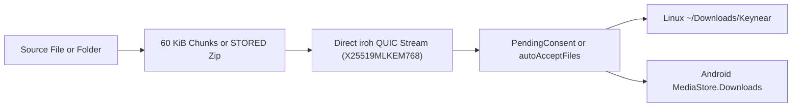

# File Sharing

`Keynear` (`0.3.0-orion`) streams files and directories directly between paired peers over relay-free `iroh` QUIC streams.

## Transfer Pipeline

## Streaming Mechanics

- Individual files stream in 60 KiB (`61_440`-byte, `STREAM_CHUNK_BYTES`) chunks over `QuicStreamKind::RawFileChunk`. On Android, `CoreClient` inserts a `MediaStore.Downloads` row with `IS_PENDING = 1`, passes `ParcelFileDescriptor.detachFd()` (`OwnedFd` in Rust) to `OrionNodeHandle.provide_receive_fd` or `send_fd` without a JVM heap copy, and clears `IS_PENDING = 0` on completion or deletes the pending row on error or cancellation.
- Directories and multi-file batches stream as uncompressed `CompressionMethod::Stored` zip archives (`zip::ZipWriter::new_stream`) over `QuicStreamKind::StoredZipArchive` using `1 MiB` (`1_048_576`-byte, `ZIP_IO_BUFFER_BYTES`) buffered I/O. Senders skip symlinks (`symlink_metadata`). Receivers spool and validate SHA-256 against `TransferComplete` before unpacking via `ZipArchive` into `incoming_directory` (default `~/Downloads/Keynear` on Linux), rejecting path traversal (`enclosed_name()`), symlinks, encrypted entries, non-`Stored` entries, and byte counts exceeding `TransferOffer.total_bytes`.

## Transfer Consent and Auto-Accept

- Incoming `TransferOffer` messages from authenticated paired devices enter `PendingConsent` by default and do not write target files until approved (`TransferConsent(accepted = true)`), transitioning through `Active` to `Completed`, `Cancelled`, or `Failed`.
- Per-device `PairedDevice.auto_accept_files` overrides and global `DaemonConfig.auto_accept_from_paired` (both `false` by default) bypass the consent prompt and transition paired offers straight to `Active`. Declining an offer returns `TransferConsent(accepted = false)` without touching target storage.

## Current Entrypoints and Upcoming OS Integrations

- **Linux CLI and daemon**: `keynear-linux` executes `--send <device_id> <path>...`, `--accept <transfer_id>`, `--decline <transfer_id>`, `--cancel <transfer_id>`, and `--transfers` over the `0o600` `daemon.sock` Unix socket.
- **Linux settings UI**: `keynear-settings` provides per-device `Auto-accept files` switches and an `Active transfers` card (`Accept`, `Decline`, `Cancel`).
- **Android UI and notifications**: `PairingNotificationManager` posts incoming transfer consent (`Accept`/`Decline`), completion, and error notifications; `MainActivity` exposes the `Active transfers` card and per-device `Auto-accept files` switches; `ShareActivity` provides a paired-device target picker for `ACTION_SEND` and `ACTION_SEND_MULTIPLE`.
- **Upcoming `0.4.0-aquila` integrations**: `ksni` system tray menus, `ashpd` (`xdg-desktop-portal`) file pickers, Nautilus/Dolphin/Yazi file-manager context menus, Direct Share shortcuts, and `Notification.ProgressStyle` Live Updates backed by `User-Initiated Data Transfer Jobs` are scheduled for `0.4.0-aquila`.
