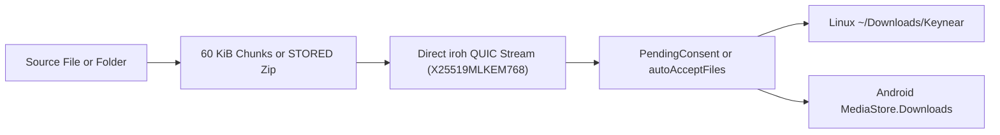

# File Sharing

Keynear (`1.1.0-perseus`) streams files and directories directly between paired peers over relay-free `iroh` QUIC.

## Transfer Pipeline

## Streaming Mechanics

Keynear uses two streaming paths depending on the source.

- Individual files stream in 60 KiB (`61_440`-byte, `STREAM_CHUNK_BYTES`) chunks over `QuicStreamKind::RawFileChunk`. On Android, `CoreClient` handles the receive side.
  - It inserts a `MediaStore.Downloads` row with `IS_PENDING = 1`.
  - It passes `ParcelFileDescriptor.detachFd()` (`OwnedFd` in Rust) to `OrionNodeHandle.provide_receive_fd` or `send_fd` without a JVM heap copy.
  - It clears `IS_PENDING = 0` on completion.
  - It deletes the pending row on error or cancellation.
- Directories and multi-file batches stream as uncompressed `CompressionMethod::Stored` zip archives (`zip::ZipWriter::new_stream`) over `QuicStreamKind::StoredZipArchive`. They use `1 MiB` (`1_048_576`-byte, `ZIP_IO_BUFFER_BYTES`) buffered I/O. Sender and receiver handle archives as follows.
  - Senders skip symlinks with `symlink_metadata`.
  - Receivers spool the archive and validate SHA-256 against `TransferComplete` before unpacking it with `ZipArchive` into `incoming_directory` (default `~/Downloads/Keynear` on Linux).
  - Receivers reject path traversal (`enclosed_name()`), symlinks, encrypted entries, non-`Stored` entries, and byte counts exceeding `TransferOffer.total_bytes`.

## Resumable Transfers and On-Demand Browsing

Resumable transfers and the virtual filesystem work as follows.

- The module `crates/keynear-core/src/resume.rs` records verified 60 KiB chunks in a bit-packed `ChunkBitmap` bounded at `16_384` bytes. It extends a rolling SHA-256 chain once per chunk. Resumption uses these checks.
  - A `TransferCheckpoint` carries the bitmap, the rolling digest, a monotonic `sequence`, and a byte count that the receiver validates against the bitmap before skipping any bytes.
  - `resume_from_checkpoint` returns the first unverified chunk only when both peers advertise `CAP_RESUMABLE_TRANSFER` (`0x100`) and the checkpoint is newer than the last accepted one. A peer without the capability starts from chunk zero.
  - `TransferComplete.sha256_digest` still verifies the whole transfer in constant time.
- The module `crates/keynear-core/src/vfs/` models paired remote roots and opaque document identifiers. It builds an on-demand `ReadPlan` that clamps offsets to the file size and caps each request at `STREAM_CHUNK_BYTES`. The module `crates/keynear-linux/src/fuse/` drives that model through an injectable `FuseMountBackend`. Two conditions apply.
  - When kernel FUSE or `libfuse3` is absent, the backend logs `perseus_fuse_unavailable` and the daemon continues.
  - The real `fuser` adapter is optional behind the `fuse` Cargo feature.
- On Android, `KeynearDocumentsProvider` is registered as a Storage Access Framework document provider. It exposes paired Linux shared directories in the system `Files` app and document pickers. `openDocument` returns a `ParcelFileDescriptor` whose write end is fed by `provide_vfs_read_fd`. A missing peer yields an empty root set rather than an error.

## Transfer Consent and Auto-Accept

Incoming transfers are gated by consent.

- Incoming `TransferOffer` messages from authenticated paired devices enter `PendingConsent` by default. They do not write target files until the receiver approves them with `TransferConsent(accepted = true)`. The transfer then moves through `Active` to `Completed`, `Cancelled`, or `Failed`.
- Per-device `PairedDevice.auto_accept_files` and global `DaemonConfig.auto_accept_from_paired` both default to `false`. Either one bypasses the consent prompt and moves paired offers straight to `Active`. Declining an offer returns `TransferConsent(accepted = false)` without touching target storage.

## Desktop and Mobile Entrypoints

Keynear exposes transfers through desktop and mobile interfaces.

- On Linux, `keynear-linux` runs over the `0o600` `daemon.sock` Unix socket. It handles `--send <device_id> <path>...`, `--accept <transfer_id>`, `--decline <transfer_id>`, `--cancel <transfer_id>`, and `--transfers`. When a graphical D-Bus session is available, it registers a `ksni` `StatusNotifierItem` tray menu. It also posts `org.freedesktop.Notifications` consent and status alerts with inline actions.
- The Linux settings portal uses `ashpd` (`xdg-desktop-portal`) file and folder choosers. `keynear-settings` provides:
  - Sending files.
  - Toggles for global `auto_accept_from_paired` or per-device `Auto-accept files`.
  - Inline rename of paired devices.
  - `Active transfers` with `Accept`, `Decline`, and `Cancel`.
  - `--send-picker [--device <id>]` and `--share [--device <id>] [--] <path>...` entrypoints for the Nautilus (`packaging/linux/integrations/nautilus/send-via-keynear`), Dolphin (`packaging/linux/integrations/dolphin/keynear-send.desktop`), and Yazi (`packaging/linux/integrations/yazi/keynear.yazi/main.lua`) context-menu integrations.
- On Android, `PairingNotifier` posts incoming consent prompts with `Accept` and `Decline`, completion and error alerts, and ongoing progress notifications. Progress uses two formats.
  - Android 16 (API 36) uses `Notification.ProgressStyle` with three segments (`Prepare`, `Transfer`, `Complete`).
  - API 31–35 uses `NotificationCompat` progress bars backed by `KeynearTransferJobService` (`User-Initiated Data Transfer Jobs`).

  `MainActivity` exposes `Active transfers`, paired-device rename, and per-device `Auto-accept files` switches. `ShareActivity`, backed by `IntentResolver`, renders a translucent bottom-sheet picker synchronized with `DirectShareManager` Direct Share targets (`res/xml/share_targets.xml`).
