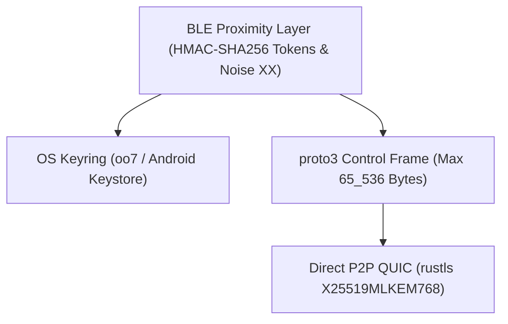

# Threat Model

`Keynear` eliminates cloud accounts, remote relay servers, and plaintext credential storage by design.

## Trust Boundaries

## Security Controls

- **BLE Proximity Layer**: Rotating 6-byte HMAC-SHA256 presence tokens prevent passive tracking. Initial pairing requires physical proximity and manual 6-digit verification code confirmation over `Noise_XX_25519_ChaChaPoly_BLAKE2s`.
- **Control Framing**: `keynear-core` enforces `MAX_CONTROL_FRAME_BYTES` (`65_536` bytes) before decoding `proto3` control frames to prevent unbounded allocation from malformed or oversized payloads.
- **QUIC Data Link**: Direct peer-to-peer QUIC (`iroh` with public relays and DNS/pkarr disabled) negotiates TLS 1.3 with hybrid post-quantum `X25519MLKEM768` (RFC 10024).
- **Secret Isolation**: `PairedDevice` serializable records omit `irk` and `reconnectSecret`. Pairwise secrets stay inside `oo7` (`org.freedesktop.secrets`) and Android Keystore.
