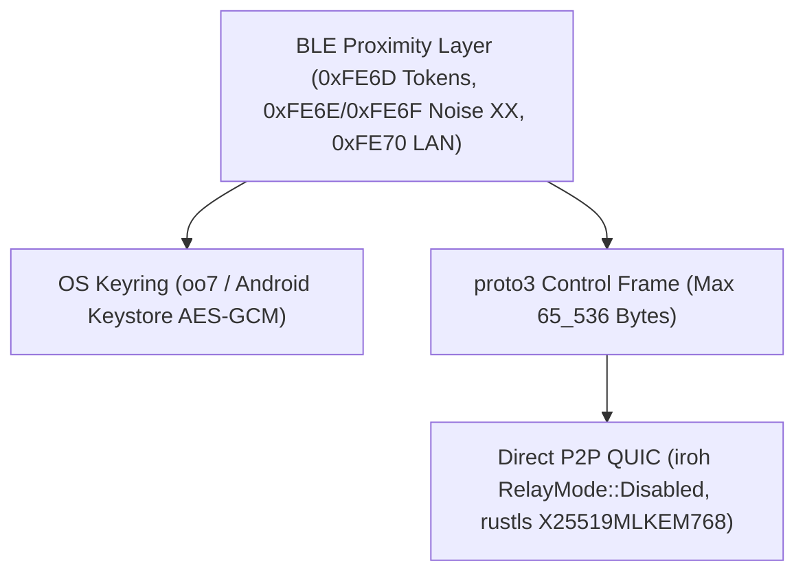

# Threat Model

`Keynear` eliminates cloud accounts, remote relay servers, and plaintext credential storage by design.

## Trust Boundaries

## Security Controls

- **BLE proximity and LAN endpoint encryption**: `0xFE6D` `PairedOnly` beacons pack rotating 6-byte HMAC-SHA256 presence tokens (`device_id || u32 counter` keyed by `irk`) and 14-byte AES-256-GCM encrypted state payloads (keyed by `reconnect_secret`) into 24 bytes. Ephemeral LAN endpoints advertised over GATT characteristic `0xFE70` (`LAN_ENDPOINT_CHAR_UUID`) are encrypted with `AES-256-GCM` keyed by `reconnect_secret` with random 96-bit nonces and AAD `"KN_LAN1" || device_id`.
- **Noise XX pairing**: Pairing executes `Noise_XX_25519_ChaChaPoly_BLAKE2s` over BLE GATT (`0xFE6E` and `0xFE6F`) with a strict 512-byte frame ceiling (`MAX_GATT_PAIRING_FRAME_BYTES`), a 120-second verification deadline (`PAIRING_TIMEOUT_SECS`), and a mandatory 6-digit BLAKE2s verification code match before persisting peer trust.
- **Secret and IPC isolation**: `irk`, `reconnect_secret`, local static X25519 keys, and the local 32-byte `iroh` Ed25519 key (`quic_ed25519`) live exclusively in `oo7` (`org.freedesktop.secrets`) on Linux and Android Keystore (`AES/GCM/NoPadding`) on mobile, wrapped in `Zeroizing` with redacted `Debug` output. `devices.toml` stores only non-secret device metadata (`last_endpoint_id`, `last_lan_address`, `auto_accept_files`, identifiers), store loaders reject symlinks and traversal `device_id` strings, and `keynear-linux` isolates `daemon.sock` (`0o600`) inside a `0o700` directory.
- **Bounded control framing and FD ownership**: `keynear-core` enforces `MAX_CONTROL_FRAME_BYTES` (`65_536` bytes) before allocating or decoding `proto3` control frames or QUIC stream envelopes. Across UniFFI, `wrap_raw_fd` immediately transfers raw descriptors into single-owner `OwnedFd` handles to prevent FD leaks and double-close `EBADF`.
- **Direct P2P QUIC and streaming sanitization (`0.3.0-orion`)**: `OrionQuicNode` builds `iroh` with `Endpoint::builder(presets::Empty)` and `RelayMode::Disabled` (zero relays, zero DNS/pkarr lookups) and pins hybrid post-quantum `X25519MLKEM768` (RFC 10024). `PairedPeerHooks::after_handshake` and constant-time `HandshakePayload.auth_proof` HMAC checks reject unpaired or impersonating peers before transfer streams open. `TransferEngine` holds paired offers in `PendingConsent` unless `auto_accept_files` is enabled, skips symlinks on send, verifies SHA-256 and byte caps against `TransferOffer.total_bytes`, and rejects zip-slip (`enclosed_name()`), symlink, encrypted, and compressed zip entries.
