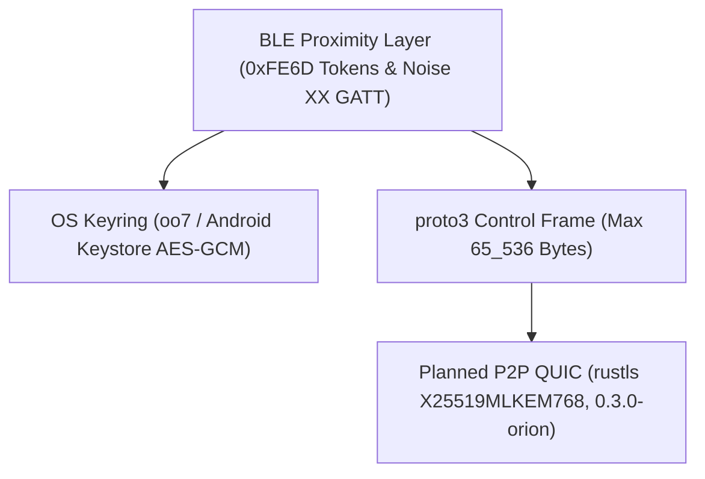

# Threat Model

`Keynear` eliminates cloud accounts, remote relay servers, and plaintext credential storage by design.

## Trust Boundaries

## Security Controls

- The BLE proximity layer in `0.2.0-cygnus` packs rotating 6-byte HMAC-SHA256 presence tokens (`device_id || u32 counter` keyed by `irk`) and 14-byte AES-256-GCM encrypted state payloads (keyed by `reconnect_secret`) into 24-byte `PairedOnly` beacons, which prevents passive tracking and state spoofing.
- Noise XX pairing executes `Noise_XX_25519_ChaChaPoly_BLAKE2s` over BLE GATT on `0xFE6E` and `0xFE6F` with a strict 512-byte frame ceiling (`MAX_GATT_PAIRING_FRAME_BYTES`), a 120-second verification deadline (`PAIRING_TIMEOUT_SECS`), and a mandatory 6-digit BLAKE2s verification code match before either side persists peer trust.
- Secret isolation keeps `irk` and `reconnect_secret` out of the serializable `PairedDevice` records in `devices.toml`. Pairwise secrets reside only in `oo7` (`org.freedesktop.secrets`) and Android Keystore (`AES/GCM/NoPadding`, hardware-backed where available). Key structures wrap secret bytes in `Zeroizing` and redact `Debug` and `toString()` output, and store loaders reject symlinks, oversized files, and traversal `device_id` strings.
- Bounded control framing enforces `MAX_CONTROL_FRAME_BYTES` (`65_536` bytes) before `keynear-core` decodes a `proto3` control frame, which prevents unbounded allocation from malformed or oversized payloads.
- The planned QUIC data link in `0.3.0-orion` connects peers directly through `iroh` with public relays and DNS/pkarr disabled, and targets TLS 1.3 with hybrid post-quantum `X25519MLKEM768` (RFC 10024).
