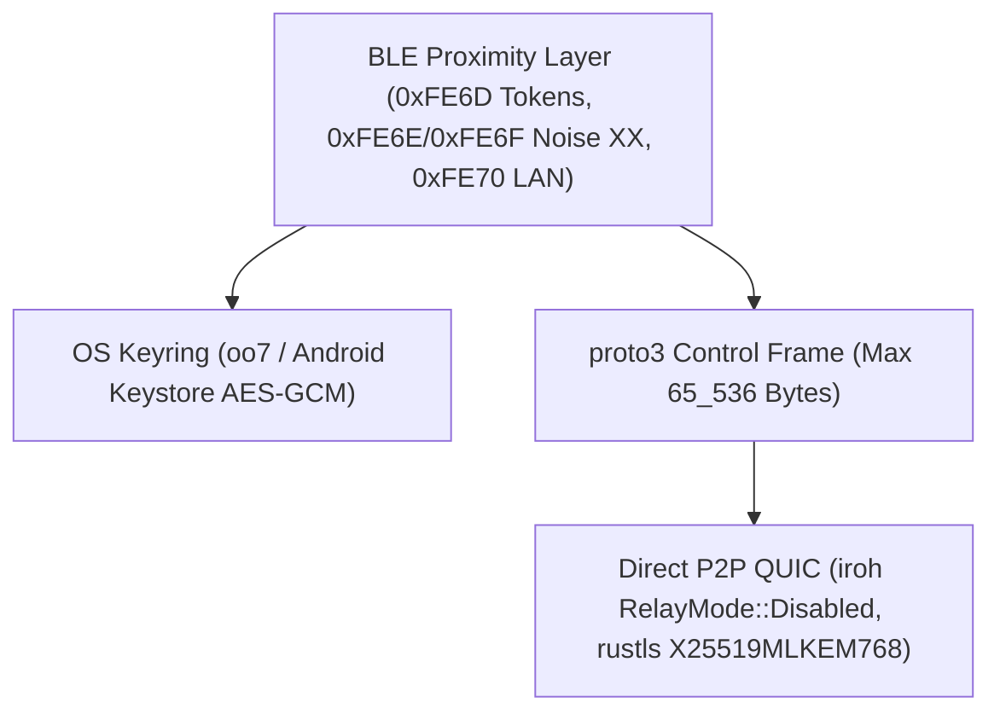

# Threat Model

Keynear eliminates cloud accounts, remote relay servers, and plaintext credential storage by design.

## Trust Boundaries

## Security Controls

Keynear applies the following security controls.

- `0xFE6D` `PairedOnly` beacons pack presence and state data into 24 bytes.
  - A rotating 6-byte HMAC-SHA256 presence token (`device_id || u32 counter` keyed by `irk`).
  - A 14-byte AES-256-GCM encrypted state payload keyed by `reconnect_secret`.

  Ephemeral LAN endpoints advertised over GATT characteristic `0xFE70` (`LAN_ENDPOINT_CHAR_UUID`) are encrypted with `AES-256-GCM` keyed by `reconnect_secret`, with random 96-bit nonces and AAD `"KN_LAN1" || device_id`.
- Pairing executes `Noise_XX_25519_ChaChaPoly_BLAKE2s` over BLE GATT (`0xFE6E` and `0xFE6F`). It applies three limits.
  - A strict 512-byte frame ceiling (`MAX_GATT_PAIRING_FRAME_BYTES`).
  - A 120-second verification deadline (`PAIRING_TIMEOUT_SECS`).
  - A mandatory 6-digit BLAKE2s verification code match before the devices persist peer trust.
- Secrets and IPC are isolated from ordinary configuration.
  - `irk`, `reconnect_secret`, local static X25519 keys, and the local 32-byte `iroh` Ed25519 key (`quic_ed25519`) live exclusively in `oo7` (`org.freedesktop.secrets`) on Linux and Android Keystore (`AES/GCM/NoPadding`) on mobile. The values are wrapped in `Zeroizing` and have redacted `Debug` output.
  - `devices.toml` stores only non-secret device metadata (`last_endpoint_id`, `last_lan_address`, `auto_accept_files`, identifiers). Store loaders reject symlinks and traversal `device_id` strings.
  - `keynear` isolates its IPC socket `daemon.sock` (`0o600`) inside a `0o700` directory.
- `keynear-protocol` and `keynear-core` enforce `MAX_CONTROL_FRAME_BYTES` (`65_536` bytes) before allocating or decoding `proto3` control frames or QUIC stream envelopes. Across `keynear-ffi` UniFFI, `wrap_raw_fd` immediately transfers raw descriptors into single-owner `OwnedFd` handles. This prevents FD leaks and double-close `EBADF`.
- `OrionQuicNode` builds `iroh` with `Endpoint::builder(presets::Empty)` and `RelayMode::Disabled`, which means zero relays and zero DNS or pkarr lookups. It pins hybrid post-quantum `X25519MLKEM768` (RFC 10024). Peer and transfer checks then apply.
  - `PairedPeerHooks::after_handshake` and constant-time `HandshakePayload.auth_proof` HMAC checks reject unpaired or impersonating peers before transfer streams open.
  - `TransferEngine` holds paired offers in `PendingConsent` unless `auto_accept_files` is enabled.
  - It skips symlinks on send, verifies SHA-256 and byte caps against `TransferOffer.total_bytes`, and rejects zip-slip (`enclosed_name()`), symlink, encrypted, and compressed zip entries.
- `TransferCheckpoint` is validated at the decode edge. A peer cannot:
  - set a bitmap bit beyond the offer's chunk count.
  - mark a non-contiguous prefix.
  - claim a byte count that disagrees with the bitmap.
  - replay an older `sequence`.

  The rolling SHA-256 chain hashes each verified chunk exactly once, and the unchanged `TransferComplete.sha256_digest` still verifies the whole transfer in constant time.

  Remote roots and document identifiers are bounded to `128` and `256` characters. They reject control characters and traversal through `sanitize_relative_path`. Android sees them only through a `MANAGE_DOCUMENTS`-protected `DocumentsProvider`. A missing peer yields an empty root set instead of another peer's data. The FUSE backend reports unavailability instead of mounting on an untrusted or absent mount point.
- Mirrored notification, call alert, and media session messages cross the same authenticated QUIC channel and stay bounded by `MAX_CONTROL_FRAME_BYTES`. A peer cannot inject control characters into a notification title, caller name, or media title, exceed the per-field length caps, replay a stale notification or media sequence, or target an unknown player. Notification exclusions apply before any envelope is built, and mirrored content, call numbers, and media metadata stay in memory with no disk or TOML write path. Inline replies are validated for non-empty bounded text before a `NotificationAction` is emitted, and call actions are bound to a live call id and phase. A missing session bus, player, or call permission returns a typed unavailable result instead of a crash.
- Native OS surfaces apply their own boundaries.
  - `KeynearTileService` blocks unlocked `EveryoneNearby` exposure on a locked Android screen through `isLocked` and `unlockAndRun`.
  - Direct Share targets (`DirectShareManager`, `res/xml/share_targets.xml`) synchronize strictly with paired `PairedDevice` IDs and prune removed devices immediately.
  - `PairedDeviceStore::rename` and `DaemonConfig::save_to_path` enforce `MAX_DISPLAY_NAME_LEN` (`64`), `validate_display_name`, and atomic temp-file writes.
  - `ksni` tray and `zbus` desktop notification handlers enqueue non-blocking daemon commands without reading key material.
  - `keynear send --` and the Nautilus, Dolphin, and Yazi integrations pass literal paths past `--` without shell interpolation.
