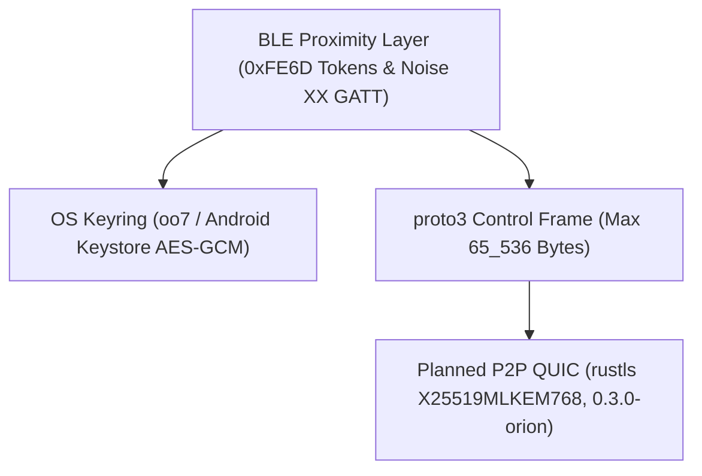

# Threat Model

`Keynear` eliminates cloud accounts, remote relay servers, and plaintext credential storage by design.

## Trust Boundaries

## Security Controls

- **BLE Proximity Layer (`0.2.0-cygnus`)**: In `PairedOnly` mode, 24-byte beacons carry rotating 6-byte HMAC-SHA256 presence tokens (`device_id || u32 counter` keyed by `irk`) and 14-byte AES-256-GCM encrypted state payloads (keyed by `reconnect_secret`) to prevent passive tracking and state spoofing.
- **Noise XX Mutual Verification**: Initial pairing executes `Noise_XX_25519_ChaChaPoly_BLAKE2s` over BLE GATT (`0xFE6E` / `0xFE6F`) with a strict `512`-byte frame ceiling (`MAX_GATT_PAIRING_FRAME_BYTES`), a `120`-second verification deadline (`PAIRING_TIMEOUT_SECS`), and a mandatory 6-digit BLAKE2s verification code match before persisting peer trust.
- **Secret Isolation & Store Integrity**: `PairedDevice` serializable records (`devices.toml`) omit `irk` and `reconnect_secret`; pairwise secrets reside exclusively in `oo7` (`org.freedesktop.secrets`) and Android Keystore (`AES/GCM/NoPadding`, hardware-backed where available). Sensitive key structures wrap secret bytes in `Zeroizing` and redact `Debug` / `toString()` outputs, and store loaders reject symlinks, oversized files, and traversal `device_id` strings.
- **Bounded Control Framing**: `keynear-core` enforces `MAX_CONTROL_FRAME_BYTES` (`65_536` bytes) before decoding `proto3` control frames to prevent unbounded allocation from malformed or oversized payloads.
- **Planned QUIC Data Link (`0.3.0-orion`)**: Direct peer-to-peer QUIC (`iroh` with public relays and DNS/pkarr disabled) is targeted to negotiate TLS 1.3 with hybrid post-quantum `X25519MLKEM768` (RFC 10024).
